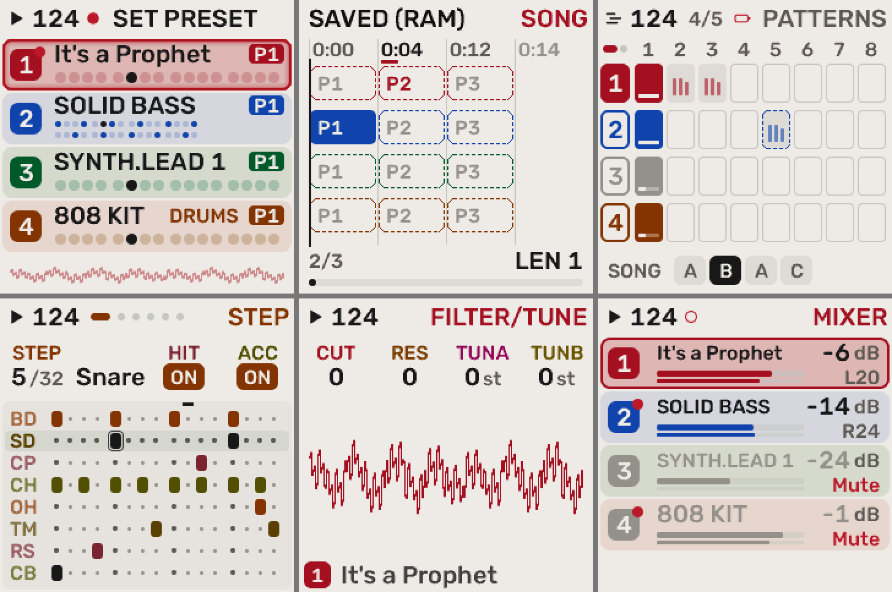
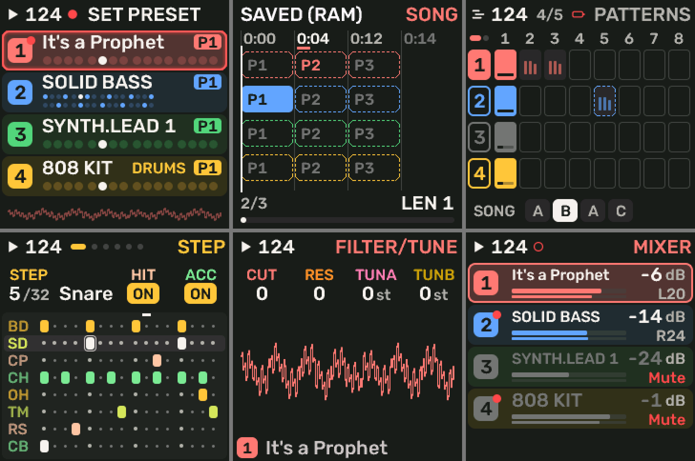

# Rumiboard — UI / UX direction

Three influences, one original look:

1. **Classic sampler hardware** (the white-and-grey FM-1 itself): warm grey chassis,
   charcoal ink, bold pad colours, a clear grid, controls that look like you can press them.
2. **Modern, clean firmware**: tidy cards, generous type, one clear focus on screen,
   restrained colour. Melodee's layout already does this well, so we keep its structure.
3. **Cartoony and playful**: sounds you can *see*, small characters, bouncy motion,
   and humour in empty states and confirmations.

We borrow the *feel*, never the trade dress: no logos, product fonts, characters,
icons or screen layouts copied from Akai, teenage engineering, BAUD GIRL or anyone else.
Everything we draw is our own.

## 1. Colour (done: first step)

`tools/gen_ui_palettes.py`:

| Palette | Role | Background / ink | Track (pad) colours |
|---|---|---|---|
| **RUMI** (default) | the chassis: light, matches the white-and-grey unit | warm grey `#EAE8E2` / charcoal `#1A1A1E` | red, cobalt, green, burnt orange |
| **1984** | the night version, named after nineteen84 (the lofi house alias) | charcoal `#1C1C1F` / off-white `#F2F0EA` | bright red, sky blue, green, yellow |

Both pass the generator's WCAG contrast checks for every track and knob shade.
On a light background the pad colours have to be fairly dark to stay readable,
which is why RUMI's orange reads as burnt orange. Melodee's palettes stay
available under Settings > COLOR.

Rendered from the firmware's own drawing code (`tests/ui_render.c`):

## 2. Shape and type

- Keep Melodee's 240 × 240 grid, cards and lanes.
- **Chunkier "pad" elements**: selected items look like a lit pad (filled, slightly
  raised), unselected ones look like unlit rubber (outlined).
- Rounded corners everywhere (already r 4–6); no sharp boxes.
- Type stays Rubik (OFL), in capitals for labels. A custom display face for big numbers
  (BPM, chord root) is a later option.

## 3. The playful layer (planned)

Each sound engine gets a **living visual** on its main page, drawn in the track's colour.
It reacts to the knobs and to notes:

| Engine | Visual idea |
|---|---|
| Sub bass | a round blob that squashes on each note; "bite" gives it little teeth |
| Sine family | a smooth worm/wave that wiggles with vibrato and FM depth |
| Pluck / bendy lead | a spring that boings with the pitch envelope and bends |
| Warm pad | a cloud that slowly brightens and grows as the "bloom" opens |
| Felted piano | a felt hammer tapping a string |
| Drums | each lane a small face that blinks when hit |
| Lofi bus | a cassette or record that wobbles with wow/flutter |

Other touches:
- A small mascot shown at boot, on the About screen, on empty patterns and on confirmations
  (e.g. it covers its eyes on "ERASE?").
- Short, bouncy transitions (overshoot and settle) for page changes and values.
- Friendly wording in empty states ("nothing here yet, press REC").

## 4. Hardware limits for animation

- The display is 240 × 240 RGB565 over SPI (about 1,000 pixels ≈ 1.3 ms to send).
  Melodee only sends tiles that changed. Animations must stay in small regions (for example
  a 96 × 64 visual) and run at about 15–25 fps, never full-screen.
- RAM is tight (see VISION.md §4). Sprites live in flash, compressed and in 1–2 bits
  per pixel, coloured by the palette at draw time, so they follow every palette.
- The audio always wins: UI drawing runs on the main loop, never in the audio interrupt.
- Every new screen must pass the existing UI render tests (layout lint, MONO gray check,
  draw cost) in `tests/ui_render.c`.

## 5. Sound families follow the palettes

Sounds come in two families, named after the two palettes:

- **RUMI**: the chill side. Sine-based keys and melodies, chillhop plucks and bendy leads,
  felted piano, sub bass, ambient pads.
- **1984**: the lofi house side (after nineteen84). Classic analog chord stabs, warm
  gritty pads, punchy drums.

Choosing a sound from one family switches the screen to that palette: a 1984 sound turns the screen
dark, a RUMI sound turns it light. The sound browser shows the two families as
separate sections. This is UI work (the browser and the palette switch), done before the sound
design that fills the families.

## 6. Order of work

1. ✅ RUMI / 1984 palettes, RUMI as the default.
2. ✅ Rebrand the power-on screen, About and the browser emulator to Rumiboard, keeping the
   Melodee/Felucca credits. (Still Melodee: the USB / Bluetooth / MIDI device names and the
   package identity; they change with the release setup.)
3. ✅ Pad-style rows on Home and the Mixer (`gfx.c` `pad_fill` / `pad_rrect`); other lists next.
4. One living visual (the sub-bass blob) as the pattern for the others.
5. RUMI / 1984 sound families in the browser, the palette following the chosen sound.
6. Mascot and transitions.
